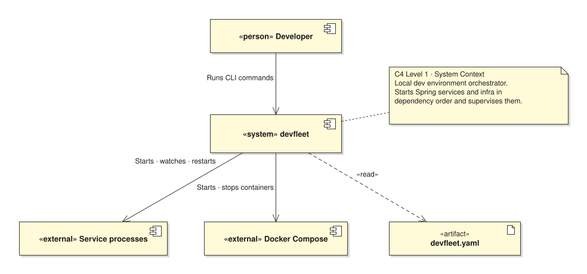
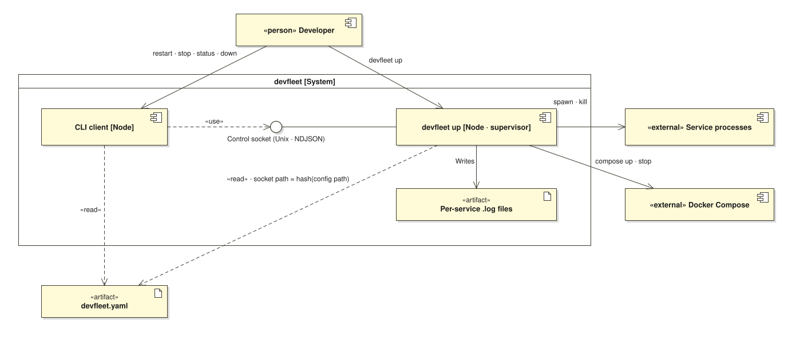
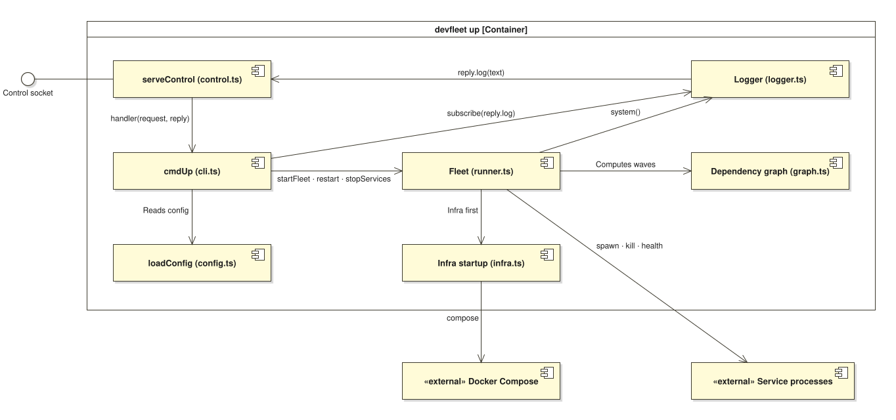
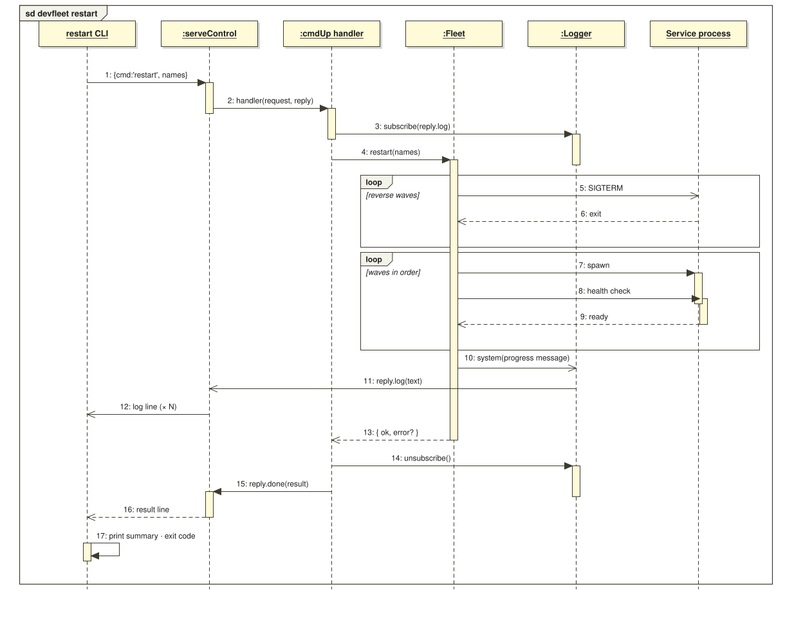

# devfleet

[](https://github.com/MSbtff/devfleet/actions/workflows/ci.yml)
[](https://www.npmjs.com/package/@devmsbtff/devfleet)
[](LICENSE)

A CLI that starts many microservices locally **in dependency order**, **waits until each one is healthy**, and **collects all logs in one place**.

Running a Spring Boot microservice project locally usually looks like this:

- Open nine terminals, run `set -a; source .env`, then `./gradlew bootRun` in each one
- Services start before Eureka is up and fill the logs with registration errors
- You hit Ctrl+C, but a JVM survives, and the next run fails with `Port 7071 was already in use`
- You jump between terminals trying to find which service printed what

devfleet turns all of that into one command.

```bash
devfleet init        # analyze the project and generate devfleet.yaml
devfleet up          # infra (Docker) → Eureka → business services → Gateway
```

Output from a real 9-service project (all services ready in about 41 seconds):

```
devfleet              │ ✔ infra ready in 0.1s
devfleet              │ ✔ eureka-server ready in 6.1s · http://127.0.0.1:8761
devfleet              │ account-service starting: ./gradlew bootRun  (AccountService)
devfleet              │ menus-service starting: ./gradlew bootRun  (MenusService)
...
devfleet              │ ✔ gateway-server ready in 5.1s · http://127.0.0.1:7070
devfleet              │
devfleet              │ SERVICE            STATUS   PORT  READY  PID
devfleet              │ eureka-server      ✔ ready  8761  6.1s   14719
devfleet              │ account-service    ✔ ready  7071  17.3s  14807
devfleet              │ menus-service      ✔ ready  7072  13.1s  14810
devfleet              │ disposals-service  ✔ ready  7077  6.1s   15066
devfleet              │ gateway-server     ✔ ready  7070  5.1s   15296
```

## Features

- **Project analysis with `init`**: finds Spring Boot apps (Gradle or Maven, single or multi-module) and fills in the port, Actuator health URL, and run command.
  With `init --jar`, each app is built once and run with `java -jar` instead of `bootRun`, so no Gradle daemon stays busy per service.
  Placeholders such as `${PORT:7071}` in `application.yml` are resolved against `.env`.
  If there is a `compose.yaml`, service order and required infrastructure (DB, Redis, Kafka, …) are taken from `depends_on`.
- **Spring Cloud awareness**: apps that use Config Server, Eureka, Consul, or Nacos are started after that server.
  If the server is an app in the same project, devfleet depends on it; if it is an external product, devfleet finds it in `compose.yaml` and adds it to infra, or warns when it cannot.
  Mutual setups — Config Server registers with Eureka while Eureka reads its config from Config Server — are ordered Config → Eureka without creating a cycle.
- **Dependency order + health waiting**: a service starts only *after* its dependencies are ready. Services at the same level start in parallel.
- **Infra readiness that understands init containers**: Compose services count as ready when they are running and healthy, or when a one-shot init container exits with code 0.
- **Failure propagation**: when a service dies during startup, devfleet shows its last log lines and skips every service that depends on it.
- **Automatic restarts**: with `restart: on-failure`, a service that crashes while you work (a dropped DB connection, an out-of-memory error) comes back on its own instead of staying down until you notice. devfleet waits a little longer after each crash in a row and gives up when restarting does not help.
- **Port conflict reporting**: tells you which PID holds a port. A healthy service that is already running (for example, one you are debugging in your IDE) is reused as-is.
- **Clean shutdown**: one Ctrl+C stops everything in reverse order (Gateway → business services → Eureka). Processes outside the process group, such as JVMs forked by the Gradle daemon, are found by port and stopped too.
- **Unified logs**: every line is prefixed with a colored service name, and each service also gets `.devfleet/logs/<service>.log`.

## Installation

Requires Node.js 20 or later.

```bash
npx @devmsbtff/devfleet init        # try it without installing
npm install -g @devmsbtff/devfleet   # or install the devfleet command globally
```

From source:

```bash
git clone https://github.com/MSbtff/devfleet.git && cd devfleet
npm install         # also builds the TypeScript sources into dist/
npm link            # makes the devfleet command available everywhere
```

## Usage

| Command | Description |
|---|---|
| `devfleet init` | Analyze the current folder and create `devfleet.yaml` (`--print`: print instead of writing, `--force`: overwrite, `--jar`: [jar mode](#jar-mode)) |
| `devfleet up [name...]` | Start services or groups together with their dependencies. Starts everything when no name is given |
| `devfleet status` | Port and health status of each service, plus the process holding the port. While `devfleet up` is running, a FLEET column shows what it knows (starting, crashed, stopped, …) |
| `devfleet restart <name...>` | Restart services or groups inside the running `devfleet up`, from another terminal. Services with a `build` are rebuilt first (`--no-build` skips it) |
| `devfleet stop <name...>` | Stop services or groups inside the running `devfleet up`; `devfleet restart` brings them back |
| `devfleet logs <name> [-f]` | Show a service's log file |
| `devfleet down` | Stop the running `devfleet up` (if any) and the infra containers (data volumes are kept) |

Options for `up`

| Option | Description |
|---|---|
| `--no-deps` | Don't start dependencies; only check that they are already running |
| `--no-infra` | Leave Docker Compose infrastructure alone |
| `--down` | Stop the infra containers on exit as well |
| `--no-build` | Skip the services' `build` commands and run what was built last time |
| `--only a,b` | Show only these services' logs on screen (all logs are still written to files) |
| `-q`, `--quiet` | Show only status messages on screen |
| `--dry-run` | Print the start plan without running anything |

Common patterns

```bash
devfleet up account-service            # just Eureka + Account (dependencies included automatically)
devfleet up gateway-server -q          # start everything, keep the screen quiet
devfleet up --only account-service     # start everything, watch only Account's logs
devfleet up account-service --no-deps  # Eureka is already running in your IDE debugger
```

### Controlling a running `devfleet up`

`devfleet up` keeps running in its terminal. From any other terminal in the same project you can:

```bash
devfleet restart account-service       # stop it, start it again, wait until it is healthy
devfleet restart core                  # groups work too: dependents stop first, then start in dependency order
devfleet stop menus-service            # stop one service; the rest keep running
devfleet down                          # stop everything, like Ctrl+C in the up terminal, then stop the infra
```

- `restart` and `stop` only touch the services you name. Services that depend on them keep running, which suits Spring apps that reconnect to Eureka or a Config Server on their own.
- `restart` also works on a service that crashed, failed to start, or was skipped, as long as its dependencies are ready.
- Progress is shown in both terminals, and the command exits with 1 if a service does not become ready.
- `devfleet up` stays open while a service you stopped on purpose could be restarted, so stopping everything with `devfleet stop` does not end it; use Ctrl+C or `devfleet down`.
- The commands talk to `devfleet up` through a local socket keyed by the path of `devfleet.yaml`. Only one `devfleet up` per config file accepts these commands; a second one prints a note and runs without it.
- The socket lives in a directory only you can use: `$XDG_RUNTIME_DIR/devfleet/` when that is set, otherwise `devfleet-<uid>/` in the temp folder, created with mode 700. devfleet refuses a directory that is a symlink, belongs to another user, or is open to group or others, and the socket itself is mode 600. On Windows it is a named pipe.

## Configuration (`devfleet.yaml`)

```yaml
env_file: .env                 # environment variables injected into every service
env:                           # extra variables (take precedence over env_file)
  SPRING_PROFILES_ACTIVE: local
restart: on-failure            # default for every service: restart services that crash after becoming ready (default: no)
max_restarts: 3                # automatic restarts in a row before giving up, default 3

infra:                         # services started with `docker compose up -d` before the apps
  compose_file: compose.yaml   # for several files: compose_files: [a.yaml, b.yaml]
  services: [mariadb, redis, kafka]
  stop_on_exit: false
  timeout: 180                 # seconds to wait until containers are healthy (or init containers exit 0)

services:
  eureka-server:
    dir: eurekaServer          # working directory, relative to this file
    cmd: ./gradlew bootRun     # shell command
    port: 8761                 # used for port-conflict checks and shutdown cleanup
    health: http://127.0.0.1:8761/actuator/health

  account-service:
    dir: AccountService
    cmd: ./gradlew bootRun
    port: 7071
    depends_on: [eureka-server]
    env_file: AccountService/.env.local   # optional per-service env file
    health:
      http: http://127.0.0.1:7071/actuator/health
      timeout: 300             # seconds, default 180
    stop_timeout: 20           # seconds to wait after Ctrl+C, default 15
    restart: no                # overrides the top-level restart for this service

groups:
  core: [eureka-server, account-service]
```

When `health` is omitted, the service is ready as soon as `port` accepts connections. With `health: none` it is ready right after it starts.
HTTP health checks treat 2xx and 3xx responses as healthy. Spring Actuator returns 503 while a dependency such as the DB is DOWN, so devfleet waits until the service is actually usable.

### Automatic restarts

Automatic restarts start a service again when it crashes while `devfleet up` is running.
Without them, a service that dies while you work stays down until you notice — usually when a request fails — and run `devfleet restart` yourself.

They are off by default. Turn them on for every service at the top level, and override per service:

```yaml
restart: on-failure     # every service: start it again when it crashes after becoming ready
max_restarts: 3         # optional: restarts in a row before giving up, default 3

services:
  eureka-server:
    restart: no         # but never this one
  account-service:
    max_restarts: 5     # and give this one more tries
```

A crash then looks like this in the `devfleet up` terminal, and the service is ready again a moment later:

```
✖ account-service exited (code 1)
! account-service restarting in 1s (attempt 1/3)
```

Turn them on when crashes are transient and a fresh start fixes them:

- a dropped connection to the DB, Eureka, or a Config Server that makes the app exit
- a service that occasionally runs out of memory after running for a long time
- a backend you leave running all day, or one that frontend developers only consume, where nobody watches its logs

Leave them off when you want to see the crash: while you debug why a service dies, an automatic restart only gets in the way.
They do not help with a bug that crashes the service every time either; devfleet gives up after `max_restarts` tries in a row.

How it works:

- devfleet waits 1 second before the first restart, then twice as long before each further restart in a row (2s, 4s, …, at most 30s).
- After `max_restarts` restarts in a row it gives up and leaves the service as crashed. A service that stayed up for a minute before crashing gets its full `max_restarts` again.
- Services that depend on the crashed one keep running. If its own dependencies are not ready when the restart is due, that attempt fails and counts toward `max_restarts`.
- Failures during the first start (exiting before becoming ready, or a health check timeout) are not retried: they usually mean a configuration problem.
- `devfleet stop` or `devfleet restart` from another terminal cancels a pending automatic restart and takes over, so you can stop a service that keeps crashing. `devfleet status` shows how many times each service was restarted.

### Jar mode

`bootRun` keeps a Gradle daemon busy for as long as the app runs, so nine services mean nine daemons on top of nine apps (see the notes below).
In jar mode devfleet builds each app once and runs the jar with `java -jar`:

```bash
devfleet init --jar     # generate build + jar instead of cmd: ./gradlew bootRun
```

```yaml
services:
  account-service:
    dir: AccountService
    build: ./gradlew bootJar          # runs before the service starts
    jar: build/libs/*.jar             # relative to dir; the newest match wins, *-plain.jar is skipped
    java_opts: -XX:TieredStopAtLevel=1   # optional, placed before -jar
    port: 7071

  menus-service:                      # a module of a multi-module build
    dir: apps/menus                   # the app runs from its own folder
    build:
      cmd: ./gradlew :apps:menus:bootJar
      dir: .                          # but is built from the root project
    jar: build/libs/*.jar
```

- **One build at a time.** Builds start right away in dependency order, while infra and dependencies are still coming up, but only one runs at a time (`build_concurrency`, default 1). A service whose dependency fails has its build cancelled, and a service that is already running (in your IDE, say) is reused without building. Gradle then reuses one daemon for the builds (when the projects use the same Gradle version and JVM) instead of keeping one busy per service. Raise `build_concurrency` to build faster with more daemons.
- **The build daemon is stopped when the builds are done.** An idle Gradle daemon stays in memory for three hours, so once no build is running or waiting, devfleet stops the daemons its builds used (about 0.6 GB each even for a small project). Builds get their own daemon registry under `.devfleet/gradle-daemons` through `GRADLE_OPTS`, so the daemons your IDE or a `bootRun` service uses are never shared with them and never stopped. The cost is a cold daemon on each `devfleet restart` build; set `gradle_daemon: keep` at the top level to keep the daemon instead.
- **`devfleet restart` rebuilds first.** Edit the code, run `devfleet restart account-service`, and devfleet builds the new jar while the old one keeps serving, then swaps them. If the build fails, the running process is left alone. `devfleet restart --no-build` restarts without building, and `devfleet up --no-build` starts from the jars built last time. Automatic restarts after a crash never rebuild.
- **A copy runs, not the build output.** devfleet copies the jar to `.devfleet/jars/<service>.jar` and runs that, so a build can overwrite `build/libs` while the service is running.
- **Java comes from `JAVA_HOME`** when it is set (in your shell, `env`, or `env_file`), otherwise from `PATH`.
- `build` works without `jar` too: any service can run a build command before its `cmd`.
- **Most of the memory left is the apps, so trim them with `java_opts`.** `bootRun` starts apps with `-XX:TieredStopAtLevel=1` (Spring Boot's optimized launch) and `java -jar` does not, so `init --jar` adds it to every service. Capping the heap saves far more: add `-Xmx256m -XX:+UseSerialGC` if your apps fit in that heap.
- **Measured in the 9-service project above** (Java memory one minute after everything was ready): `bootRun` used 7.1 GB, of which 4.5 GB were Gradle daemons and wrapper clients. Jar mode used 3.8 GB, 3.5 GB with `-XX:TieredStopAtLevel=1`, and 2.6 GB with `-Xmx256m -XX:+UseSerialGC -XX:TieredStopAtLevel=1`. After shutdown, `bootRun` left two idle daemons (0.85 GB); jar mode left nothing.
- If your build uses Kotlin, `kotlin.compiler.execution.strategy=in-process` in `gradle.properties` keeps the Kotlin compiler from starting a daemon of its own.

### Notes for Gradle `bootRun`

- **The health timeout includes compile time.** On a cold start (no Gradle daemon, nothing compiled yet) every service starts its own daemon and compiles before the app boots. In the 9-service project above, the slowest service took about 20 seconds from a cold start, well within the 180-second default. Raise `health.timeout` for large modules.
- **Each `bootRun` keeps a Gradle daemon busy.** A running `bootRun` occupies its daemon, so N services mean N daemons in addition to N application JVMs. In the same project this came to about 3.3 GB for the daemons and 3.1 GB for the apps and wrapper clients. If memory is tight, start only what you need (`devfleet up account-service`), or run the remaining services as Compose containers. Run `./gradlew --stop` afterwards to release the daemons, or use [jar mode](#jar-mode).

## Example

Try it without Spring:

```bash
cd examples/demo
node ../../dist/cli.js up
```

## Development

devfleet is written in TypeScript. Tests and the demo's fake services run directly through Node's type stripping, without a build step, so development requires **Node.js 22.18 or later**.

```bash
npm run typecheck   # type-check src and test
npm test            # run the .ts tests with node --test
npm run build       # produce dist/
```

| File | Responsibility |
|---|---|
| `src/cli.ts` | Commands and output |
| `src/args.ts` | Argument parsing |
| `src/config.ts` | Reading and validating `devfleet.yaml` and `.env` |
| `src/graph.ts` | Target resolution, cycle detection, start waves |
| `src/runner.ts` | Process launch, health waiting, restart and shutdown cleanup |
| `src/control.ts` | Control socket between `devfleet up` and `restart`/`stop`/`status`/`down` |
| `src/infra.ts` | Docker Compose infra startup and readiness |
| `src/init.ts` | Spring Boot and Compose project analysis |
| `src/detectors.ts` | Spring Cloud server detection rules (Config, Eureka, Consul, Nacos) |
| `src/health.ts`, `src/ports.ts` | Health checks and port ownership |
| `src/logger.ts` | Colored, prefixed logs and log files |

### Architecture

The diagrams follow the [C4 model](https://c4model.com/), zooming in one level at a time, plus a sequence diagram for `devfleet restart`.

**Level 1: System context.** devfleet sits between the developer, the local service processes, the Docker Compose infra, and `devfleet.yaml`.



**Level 2: Containers.** A running `devfleet up` is a supervisor process. The `restart`, `stop`, `status`, and `down` commands run as separate CLI processes and reach it through a local control socket. Both processes derive the socket path from the path of `devfleet.yaml`.



**Level 3: Components of `devfleet up`.** `serveControl` passes each request to a handler in `cmdUp`. The handler calls `Fleet` and subscribes to the `Logger` so progress lines go back to the client.



**`devfleet restart` sequence.** Services stop in reverse wave order (dependents first) and start again in wave order, each one only once its dependencies are ready. The client receives progress lines while this runs, then a single result line.



### Adding a detection rule

Add one object to `RULES` in `src/detectors.ts` and `init` will recognize a new component.

```ts
{
  id: 'zookeeper',
  label: 'Zookeeper',
  infraImage: /zookeeper/,                                   // find the server by compose service name or image
  uses: (app) => /spring-cloud-starter-zookeeper/.test(app.buildText),
}
```

If the server is a Spring Boot app in the same project, add `serves: (app) => ...` so the server app can be recognized.
Rules are applied in array order, and a dependency that would create a cycle with an earlier rule is not added.

## Roadmap

- [ ] Detect Node, Python, and Go services (`package.json`, `pyproject.toml`, `go.mod`)
- [x] Jar mode: build once with `bootJar` and run `java -jar`, so Gradle daemons don't stay resident per service
- [x] `devfleet restart <name>` to restart one running service from another terminal
- [ ] Restart a service when its files change (`--watch`)
- [ ] Hybrid mode: run most services as Compose containers and only the ones you are editing locally
- [ ] Verify Windows support

## License

MIT
